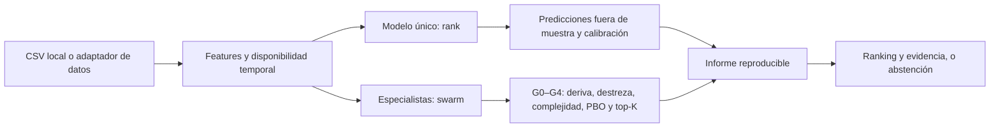

<div align="center">

# Swarmtrader

### Multi-agent research. Measurable evidence. Explicit abstention.

[](https://github.com/dalonsogomez-ai/swarmtrader/actions/workflows/ci.yml)
[](pyproject.toml)
[](LICENSE)
[](docs/ESTADO.json)

**Walk-forward evaluation · Probability calibration · Backtest overfitting controls**

[English overview](docs/OPEN_SOURCE_OVERVIEW.md) · [Quick start](#instalación) · [Architecture](docs/ARCHITECTURE.md) · [Model audit](docs/AUDITORIA_GEOMETRIA.md) · [Contributing](CONTRIBUTING.md)

</div>

---

**Herramienta de investigación para comparar modelos y agentes de selección de
acciones a un mes, con probabilidades estimadas, calibración fuera de muestra y
controles estadísticos que permiten abstenerse cuando no hay evidencia.**

Funciona en macOS (Apple Silicon), Linux y Windows. Python 3.11+. Sin claves ni
cuentas para el modo CSV. Licencia MIT.

**Estado de v1.6.0 (13 de noviembre de 2026):** investigación y backtesting.
La auditoría disponible no demuestra que los primeros valores del ranking
batan al universo; con el filtro G4, el resultado medido es **NO ACCIONABLE**.
Desde la v1.4 existe un modo opcional, `--decision conviction`, que compra
igualmente la mejor cartera que el sistema sabe construir, avisando de que la
ventaja no está demostrada ([detalles](#modo-convicción-v14-elegir-aunque-la-ventaja-no-esté-demostrada)).
La v1.5 añade `decide` + `execute`: plazo variable (3 a 31 sesiones), hora de
entrada, plan de salida por acción y plan de órdenes ejecutable tras la
apertura ([detalles](#decisión-con-plazo-y-salidas-v15-decide--execute)).
La v1.6 amplía el universo: todas las cotizadas de Alpaca (penny stocks
incluidos, con coste estimado por spread), fundamentales point-in-time de la
SEC con agentes de valor y calidad, y más plataformas (IBKR con OTC, eToro,
Lightyear) ([detalles](#más-acciones-v16-universo-ampliado-fundamentales-sec-y-más-plataformas)).
Los datos reales auditados tienen sesgo de supervivencia. El paper trading
contra un broker externo no se ha validado y el trading real no está activado.
Consulta el [estado y las limitaciones](docs/ESTADO.json), la
[auditoría](docs/AUDITORIA_GEOMETRIA.md) y la
[arquitectura](docs/ARCHITECTURE.md).

Verificación local de la v1.6.0: **332 tests pasan, 7 se omiten** (PyTorch,
arch y duckdb no instalados) en Python 3.13.18 sobre Linux; hay 6 avisos de
compatibilidad futura de pandas.
El workflow de CI comprueba Python 3.11 y 3.12 en Linux y macOS.
Las [notas de publicación](docs/PUBLICATION_NOTES.md) documentan correcciones de
la CLI y de la contabilidad del simulador. Los resultados históricos que
dependan del simulador deben recalcularse antes de reutilizarlos.

> **For English-speaking readers.** Swarmtrader is an MIT-licensed Python research
> toolkit for evaluating equity-ranking models and multi-agent ensembles. It
> combines walk-forward out-of-sample evaluation, calibrated probability
> estimates, multiple-testing controls and explicit abstention. Its published
> audit includes negative results: the selected top stocks did not outperform
> their universe, and the real-data sample has survivorship bias. The repository
> is newly public; established adoption and profitable trading are not claimed.

## De los datos a la evidencia



| Capacidad | Qué permite comprobar | Evidencia en el repositorio |
|---|---|---|
| Evaluación temporal | Separación de entrenamiento y evaluación; lags de disponibilidad | [Datos PIT](src/swarmtrader/data/pit.py), [tests](tests/test_pit_and_data.py) |
| Comparación de agentes | Si la complejidad aporta frente a alternativas más sencillas | [SPA](src/swarmtrader/stats/spa.py), [auditoría](docs/AUDITORIA_GEOMETRIA.md) |
| Abstención explícita | Si los valores elegidos realmente baten al universo | [Gates del enjambre](src/swarmtrader/swarm_rank.py), [regresiones G4](tests/test_audit.py) |
| Investigación reproducible | Controles con ruido y señal conocida; resultados también negativos | [Control sintético](scripts/swarm_null_test.py), [resultados publicados](docs/results/) |
| Geometría de la información | Contraste de métricas de Fisher frente a una referencia euclídea | [Experimento](experiments/infogeo.py), [tests](tests/test_infogeo.py) |

## Probarlo sin claves API

Después de instalar, estos ejemplos usan solo los CSV y datos sintéticos del
repositorio. No requieren una cuenta de broker.

```bash
python -m swarmtrader.cli rank examples/history_long_example.csv --top 3
python -m pytest -q
python scripts/swarm_null_test.py
```

Los ejemplos sintéticos comprueban el funcionamiento del pipeline; sus métricas
no representan resultados de inversión. El comando de control puede tardar más
que el ejemplo de ranking.

---

## Instalación

```bash
git clone https://github.com/dalonsogomez-ai/swarmtrader && cd swarmtrader
make install          # crea .venv e instala todo
```

Sin `make`: `python3 -m venv .venv && source .venv/bin/activate && pip install -e ".[data,dev,report]"`

## Uso: dame las 5 mejores de mi lista

Crea un CSV con una columna `symbol` (o exporta la watchlist/posiciones de tu
broker: eToro, Lightyear, IBKR, Robinhood… todos exportan CSV):

```
symbol
AAPL
MSFT
NVDA
```

```bash
swarmtrader rank mi_universo.csv --top 5
```

Salida:

```
Fecha de analisis : 2026-09-10    horizonte: 21 sesiones    universo: 20/20 elegibles
Exito definido    : retorno > +5% en 21 sesiones   tasa base del universo: 36%

EVIDENCIA DE SENAL EN ESTE UNIVERSO: DEBIL
  rank IC medio +0.041  t=2.31  ICIR 0.54  sobre 18 fechas OOS (360 obs)
  precision@5 OOS 44%  (tasa base 36%, lift +8%, IC95 [33%, 55%])

  Senal debil: estadisticamente marginal. Trata las probabilidades como orientativas.

TOP 5
   1. NVDA       P(exito)=47%   score=+0.121   ultimo=181.40
   2. AVGO       P(exito)=44%   score=+0.098   ultimo=352.10
   ...
```

Para rankear **todo el S&P 500** (disponible en eToro y Lightyear) con datos
reales y neutralización sectorial, un solo comando (3-6 min la primera vez):

```bash
bash scripts/run_universe.sh            # o: make rank CSV=examples/sp500_universe.csv
```

Otras entradas:

```bash
swarmtrader rank --symbols-list AAPL,MSFT,NVDA,AMZN          # sin fichero
swarmtrader rank historico.csv                                # CSV con date,symbol,close[,volume]  (offline)
swarmtrader rank precios_wide.csv --volumes volumen_wide.csv  # una columna por símbolo (offline)
swarmtrader rank --etoro                                      # watchlist vía eToro Public API
swarmtrader rank mi_universo.csv --json --out resultado.json  # para automatizar
```

Opciones útiles: `--top 3`, `--horizon 10` (2 semanas), `--threshold 0.10`
(éxito = +10%), `--model ensemble` (ridge + GBDT por rank-average; LightGBM si
está instalado, si no HistGradientBoosting de sklearn), `--min-dollar-volume 5e6`.

## Señales externas: lo que de verdad mueve la precisión a un mes

Los factores de precio y volumen son el suelo. Lo que la literatura documenta
como más predictivo a 1-3 meses requiere datos que tú aportas como CSV, y el
sistema los integra con el **lag point-in-time** correcto (un dato fechado en
`t` se usa a partir de `t+1`; ajustable con `--available-lag`):

| Flag | CSV (columnas) | Features que genera | Evidencia |
|---|---|---|---|
| `--analyst` | `date,symbol,consensus[,target]` | `rev_chg_21`, `rev_chg_63` (deltas), `target_gap` | Jegadeesh et al. 2004: las **revisiones** predicen; el nivel no |
| `--earnings` | `date,symbol,eps_actual,eps_estimate` o `surprise_pct` | `sue` (63 sesiones), `earn_react_3d`, `days_since_earn` | Bernard-Thomas 1989: PEAD, drift 1-3 meses |
| `--news` | `date,symbol,headline` o `score` | `news_sent_5/21`, `news_cnt_21`, `news_sent_chg` | Lopez-Lira & Tang 2023; FinBERT local si hay `transformers`, si no léxico |
| `--insider` | `date,symbol,value` (USD netos) | `insider_net_63` | Lakonishok-Lee 2001 |
| `--short` | `date,symbol,short_interest` o `days_to_cover` | `short_int`, `short_int_chg` (negadas) | Boehmer et al.: predictor negativo |
| `--fundamentals` | `date`(filing)`,symbol,gross_profit,total_assets,net_income,cfo,book_equity,market_cap` | `gp_a`, `accruals`, `bm`, `ep` | Novy-Marx 2013; Sloan 1996 |
| `--groups` | `symbol,sector` | `industry_mom_6` + `--neutralize` (demean sectorial) | Moskowitz-Grinblatt 1999 |

```bash
swarmtrader rank universo.csv --analyst revisiones.csv --earnings resultados.csv \
  --news titulares.csv --groups sectores.csv --neutralize --model ensemble
```

La salida incluye el **IC univariante out-of-sample por factor** con su t-stat,
para que veas qué señal pesa en *tu* universo y cuál es ruido. Con los ejemplos
sintéticos del repo (que llevan una relación artificial con el futuro para
poder verificar el pipeline) el IC pasa de 0,21 a 0,35 al añadir señales; con
datos reales, espera incrementos de centésimas, no de décimas.

Fuentes gratuitas o baratas para llenar esos CSV: SEC EDGAR (Form 4 para
insiders, 8-K y 10-Q/10-K para fundamentales con fecha de filing), FINRA
(short interest quincenal), Alpaca News API / Finnhub / GDELT (titulares),
yfinance (fechas y sorpresas de resultados limitadas, sector). Lo que sigue
sin estar disponible gratis con calidad: estimaciones de analistas con
histórico (I/B/E/S) y datos de opciones.

**Lo que no está y por qué.** Patrones chartistas (hombro-cabeza-hombro,
banderas…): la evidencia de Lo-Mamaysky-Wang (2000) es marginal y no sobrevive
a costes; no se implementan. Momentum de cadena de suministro (Cohen-Frazzini):
requiere enlaces cliente-proveedor. Cambios en el lenguaje del 10-K
(Cohen-Malloy-Nguyen): horizonte de un año, no de un mes.

### eToro

La Public API de eToro autentica con las cabeceras `x-api-key` y `x-user-key`
(cuenta verificada, claves en api-portal.etoro.com). Exporta:

```bash
export ETORO_API_KEY=...  ETORO_USER_KEY=...
export ETORO_WATCHLIST_URL="https://public-api.etoro.com/api/v1/<ruta-de-watchlists>"
export ETORO_SYMBOL_FIELD=symbol   # nombre del campo con el ticker en la respuesta
swarmtrader rank --etoro
```

La ruta exacta del endpoint y el nombre del campo debes copiarlos de la
documentación vigente: este proyecto **no inventa rutas**. Los precios se
descargan después con yfinance porque los candles de eToro no tienen la
profundidad necesaria. Cualquier otra API REST que devuelva JSON con una lista
de símbolos vale: ver `generic_rest_symbols()` en `data/universe.py`.

---

## Qué significa la salida (léelo entero)

**`P(exito)` es una probabilidad calibrada, no un score maquillado.** Se ajusta
únicamente con predicciones out-of-sample sobre tu propio universo. Si el
modelo no tiene capacidad predictiva ahí, todas las probabilidades colapsan a
la tasa base del universo (la fracción de acciones que subió más del umbral en
cualquier mes). Eso es lo honesto: la herramienta se niega a inventar certeza.

**`EVIDENCIA`** resume si en tu universo hay algo que predecir:

| Etiqueta | Criterio | Qué hacer |
|---|---|---|
| FUERTE | t-stat del rank IC ≥ 3 y precision@k por encima de la tasa base con IC95 | Las probabilidades son informativas |
| DEBIL | t-stat entre 2 y 3 | Orientativo; no dimensiones capital con esto |
| NINGUNA | t-stat < 2 | Comprar el top-5 no es mejor que elegir al azar en tu lista |

**Qué hace por dentro:** 12 factores de precio/volumen (momentum 12-1 y 6-1,
reversión 1m y 1s, baja volatilidad, baja beta, anti-lotería, distancia al máximo
de 52 semanas, tendencia de volumen, iliquidez, aceleración, divergencia
volumen-precio), z-scoreados por fecha. Modelo ridge (o LightGBM) entrenado
walk-forward para predecir el **rango relativo** del retorno a 21 sesiones, con
embargo entre entrenamiento y test. 18 fechas mensuales out-of-sample producen
el diagnóstico y alimentan la calibración isotónica con shrinkage por soporte
muestral. El ranking final se hace con el modelo reentrenado hasta hoy.

**Lo que debes esperar en mercados reales:** un rank IC de 0,02-0,05 y etiqueta
DEBIL o NINGUNA la mayoría de las veces. No es un fallo de la herramienta; es
la señal/ruido real de los retornos mensuales (Gu, Kelly & Xiu 2020: R²
out-of-sample mensual ~0,3-0,4% con redes neuronales sobre 900+ predictores).
Una precision@5 del 45% con tasa base del 36% es un resultado *bueno*.

---

## Para investigadores: el torneo evolutivo

Además del modo manual, el repo incluye un harness de investigación donde una
población de agentes (combinaciones de factores + parámetros de abstención,
régimen y meta-labeling) evoluciona walk-forward, y un campeón solo se
certifica si pasa **cuatro gates**: Deflated Sharpe Ratio, Probability of
Backtest Overfitting, batir un baseline sin IA en el mismo simulador, y un
holdout de un año que el torneo nunca vio.

```bash
swarmtrader validate                                  # controles: mercado nulo no certifica
swarmtrader tournament --config config/default.toml   # torneo + informe en runs/latest/
swarmtrader signals --json                            # qué compraría el campeón hoy
swarmtrader paper --broker sim                        # un ciclo en broker simulado
swarmtrader live-check                                # pre-vuelo antes de dinero real
```

Por qué existe: en un mercado sintético **sin ninguna señal**, el torneo produce
campeones con Sharpe 2,4-2,9 y probabilidad bayesiana de edge de 0,75-0,99.
Solo el DSR/PBO los rechaza. Y con señal real inyectada, el campeón dobló al
baseline en los datos del torneo y perdió contra buy-and-hold en el holdout.
Ambos resultados se reproducen con `validate` y `tournament --signal 0.10`.

Incluye además: muerte bayesiana de agentes (no por bancarrota), meta-labeling
en numpy, guardas de riesgo inmutables fuera del genoma, modelo de IRPF español
con regla de los 2 meses, ejecución paralela, adaptador Alpaca paper/real. Ver
`config/default.toml` y los docstrings de cada módulo.

## Estructura

```
src/swarmtrader/
├── rank.py                 modo manual: CSV/API -> top-k calibrado          <- empieza aquí
├── data/universe.py        carga CSV (tickers / long / wide), eToro, REST genérico
├── data/features.py        12 factores + régimen de mercado
├── stats/calibration.py    isotónica con shrinkage, ECE
├── stats/deflated_sharpe.py, stats/overfitting.py, stats/registry.py
├── evolution/, backtest.py, tax.py, execution/, live.py, report.py
└── cli.py
examples/                   CSVs de ejemplo (tickers, long, wide)
config/default.toml         configuración del torneo y límites de riesgo
```

## Publicar tu propia copia

```bash
brew install gh && gh auth login
make publish            # crea el repo en tu GitHub y hace push
```

---

## Modo enjambre (`swarm`): la version con control de comparacion multiple

`rank` entrena **un** modelo sobre todos los factores. `swarm` entrena **nueve
agentes especialistas**, cada uno con su tesis economica y su IC medido por
separado, y despues tiene que demostrar que el conjunto vale algo antes de
proponer nada:

```bash
swarmtrader swarm mi_universo.csv --top 5
```

```
ENJAMBRE: 5 agentes activos   (4 inactivos)
   momentum   IC +0.420  t=+17.40  ICIR +4.10  (18 fechas)
   reversal   IC +0.456  t=+14.53  ICIR +3.42  (18 fechas)
   ...

FILTROS ESTADISTICOS
   G1 destreza (SPA vs azar, 8 candidatos) : p=0.0000  PASA
   G2 stack vs equiponderar                : p=0.0833  -> se usa 'eq'
   G3 PBO (persistencia del mejor agente)  : 0.00  PASA
   evidencia OOS del combinador            : FUERTE

VEREDICTO: ACCIONABLE
CARTERA SUGERIDA (fraccion del capital)
  SYN052      22.6%   ventaja esperada +3.33%
  ...
```

Los filtros (G1-G3, mas G0 desde la v1.2 y G4 desde la v1.3) son obligatorios y el veredicto por defecto es **NO
ACCIONABLE**:

- **G1** SPA de Hansen con bootstrap estacionario: ¿bate algun agente al azar
  *despues* de corregir por haberlos mirado todos?
- **G2** ¿el combinador aprendido bate a equiponderar? Si no, se reporta la
  equiponderacion. Anadir agentes no puede "mejorar" el resultado por defecto.
- **G3** PBO sobre la matriz de IC por agente: ¿persiste el orden fuera de
  muestra?

Cuando el veredicto es NO ACCIONABLE, el dimensionador devuelve una cartera
**vacia** y todas las probabilidades colapsan a la tasa base. Codigo de salida
`3`, para automatizar.

Opciones: `--alpha 0.05`, `--pbo-max 0.5`, `--spa-boot 2000`, `--kelly 0.25`,
`--max-weight 0.25`, `--target-vol 0.15`, `--previous cartera_anterior.json`
(banda de no-negociacion para no pagar coste ni impuesto por rotar de mas).

### Agente profundo y brokers (v0.6)

El decimo agente del enjambre es una red: **GRU sobre la secuencia de retornos y
volumen + atencion multi-cabeza sobre todo el corte transversal**, con sesgo
aprendido por par de sectores, entrenada con perdida de **ranking** (ListNet) y
promediando varias semillas. Entra por la misma puerta que los demas: si no
aporta, su peso es cero.

Lo importante no es que aprenda, es que **no invente**. Medido aqui: sobre ruido
puro da IC `-0.034` (t=-0.75); sobre momentum inyectado, IC `+0.413` (t=+12.39).

```bash
pip install -e ".[data,deep,broker]"

# CSV (Lightyear, eToro, IBKR, Robinhood... todos exportan CSV)
swarmtrader swarm mi_universo.csv --top 3

# Alpaca: universo completo + barras diarias, todo desde la API
export ALPACA_API_KEY_ID=...  ALPACA_API_SECRET_KEY=...
swarmtrader swarm --alpaca --max-symbols 500 --top 3

# sin red (mas rapido), o afinando la red
swarmtrader swarm mi_universo.csv --no-deep
swarmtrader swarm mi_universo.csv --deep-seeds 5 --deep-loss mixed --device mps
```

En el MacBook M5 Pro el dispositivo se detecta solo (`mps`). `--device cpu` si
quieres reproducibilidad exacta entre maquinas.

### Datos point-in-time (v0.7) — la mejora que mas importa

Hasta la v0.6 el panel eran los simbolos vivos HOY. Eso mete sesgo de
supervivencia por dos vias y la segunda es silenciosa: si una accion muere
dentro del horizonte, `precio[t+h]/precio[t]-1` es NaN y esa observacion
**desaparece del entrenamiento y de la evaluacion**. Medido aqui: la etiqueta
point-in-time recupera observaciones que promedian **-24,5%** (-72,2% las
quiebras), y en el regimen de muerte subita la etiqueta ingenua **infla el
retorno del top-5 en +0,30 puntos al mes** (~3,6 pp anuales de rentabilidad
inexistente).

```bash
pip install -e ".[data,deep,stats,store,broker,ibkr]"

# panel POINT-IN-TIME desde un volcado de Sharadar SEP / EODHD
swarmtrader swarm --sharadar sep.csv --top 3

# o desde un almacen local Parquet+DuckDB ya construido
swarmtrader swarm --store ~/swarmdata --top 3

# cuantifica el sesgo sobre TUS metricas, no sobre las de un paper
python3 experiments/survivorship.py --momentum 0.02 --delist-rate 0.12 --drift-days 0
```

### Más acciones (v1.6): universo ampliado, fundamentales SEC y más plataformas

Primero la premisa, medida: un universo mayor solo ayuda a elegir mejor las 5
primeras si el modelo ordena bien la parte ALTA del ranking, y la ganancia crece
con el logaritmo del tamaño. El enjambre de precio no lo cumple; por eso la
pieza que más importa de esta versión son los fundamentales (vía B).
Detalles y cifras en [ARCHITECTURE §18](docs/ARCHITECTURE.md).

**Vía A — todo Alpaca.** `decide` ya no corta en 1 USD ni en 1 M$ el último
día: exige mediana de 21 sesiones ≥ 100.000 $ y spread estimado ≤ 10 %, usa
756 sesiones de historia y compra los no fraccionables por acciones enteras.
Asignables en el panel del 12-nov: 3.835 frente a 2.994 (253 por debajo de 1 USD).

```bash
python3 scripts/fetch_panel.py data/panel.parquet 2018-01-01 data/nasdaqtraded.txt   # con máximo/mínimo, ADR y clases
swarmtrader decide --panel data/panel.parquet --plan runs/plan.json                  # nuevos defectos de la v1.6
```

**Vía B — fundamentales de la SEC (gratis).** Valor tal como se presentó por
primera vez, fechado por su presentación. Agentes `value` y `quality`, y datos
para `earnings`. Medido sobre supervivientes: calidad y valor tienen IC
positivo y significativo tras Holm; no hacen ganadoras a las 5 primeras.

```bash
export SEC_USER_AGENT="Nombre Apellido correo@dominio.com"     # la SEC exige identificarse
python3 scripts/fetch_sec.py data/
swarmtrader fundamentals --companyfacts data/companyfacts.zip --tickers data/company_tickers_exchange.json
swarmtrader decide --panel data/panel.parquet --fundamentals data/fundamentals_sec.csv \
    --earnings data/earnings_sec.csv --plan runs/plan.json
```

Si no quieres montar la tubería: Sharadar Core US Fundamentals (de pago) resuelve
también el mapeo histórico de tickers; Compustat/CRSP vía WRDS si tu universidad
lo tiene.

**Vía C — más plataformas.** La que más penny stocks y pequeñas ofrece es
**IBKR** (todas las cotizadas más las OTC con permiso de penny stocks). Lightyear
y eToro no añaden acciones de EE. UU. que Alpaca no tenga; añaden Europa.

```bash
swarmtrader universe --listed data/nasdaqtraded.txt --lightyear web \
    --sec-tickers data/company_tickers_exchange.json          # unión etiquetada por plataforma
swarmtrader execute runs/plan.json --broker ibkr              # TWS paper (7497), limitadas, acciones enteras
swarmtrader execute runs/plan.json --broker etoro             # demo, 1x, solo largo (ETORO_API_KEY/ETORO_USER_KEY)
swarmtrader execute runs/plan.json --broker manual --manual-venue lightyear \
    --positions-csv cartera.csv --cash 100 --prices precios.json   # Lightyear no tiene API: CSV de órdenes
```

Los adaptadores de eToro e IBKR están probados con clientes falsos, no contra
las APIs reales: valídalos en demo/paper antes de usarlos.

### Decisión con plazo y salidas (v1.5): `decide` + `execute`

`decide` es la decisión completa para la última sesión: **qué comprar** (la
cartera de crecimiento óptimo del modo convicción, sin topes, todo invertido),
**a qué plazo** (compara 3, 5, 10, 15, 21 y 31 sesiones; 31 ≈ 45 días
naturales), **cuándo entrar** (apertura de la sesión siguiente) y **cuándo
salir de cada acción** (objetivo, stop, stop móvil y plazo máximo propios,
aprendidos de los casos pasados del mismo tramo de puntuación). Escribe un plan
de órdenes JSON con identificador; `execute` lo ejecuta tras la apertura con la
misma lógica de órdenes que el ciclo (vender, esperar, comprar con el saldo
real). Lo puede ejecutar el CLI o un agente de IA que lea el JSON.

```bash
swarmtrader decide --panel panel.parquet --plan runs/plan.json            # análisis tras el cierre
swarmtrader decide --alpaca --broker alpaca --plan runs/plan.json         # universo y cuenta PAPER de Alpaca
swarmtrader execute runs/plan.json --broker alpaca                        # simula contra la cuenta
swarmtrader execute runs/plan.json --broker alpaca --execute              # envía a la cuenta PAPER
swarmtrader execute runs/plan.json --broker paper --capital 1000 --execute  # bróker simulado local: sin red ni claves
```

Con `--broker paper` no hay cotizaciones: cada compra se llena al precio de
`--prices` (JSON `{símbolo: precio}`) y, si no se da, al cierre de referencia que
viaja en el plan (el informe lo avisa: es el precio del análisis, no el de hoy).

El informe incluye el top 10 del universo con valoración de 0 a 1 y los
agentes que actúan como catalizador, la tabla de plazos, la cartera, el plan de
salida de cada posición y las alternativas medidas con los mismos escenarios.
El ciclo diario (`cycle`) lee después el plan de salida de cada posición y lo
aplica en lugar de las barreras globales.

Prueba con datos reales (cierre del 12-nov-2026, 3.313 acciones, solo
supervivientes): veredicto NO ACCIONABLE; la puntuación apenas distingue
acciones (señal retenida 0-10 %), así que la elección forzada es una cartera de
bajo riesgo de 23 posiciones (mayor peso 23,8 %), con un retorno esperado de
+1,7 % a 31 sesiones, prácticamente igual para todas. No es una apuesta: es lo
que la información de precio y volumen justifica. Detalles y decisiones de
diseño: `docs/ARCHITECTURE.md`, sección 17.

Dinero real: además de `SWARMTRADER_ALLOW_LIVE=1` y `--live`, `execute` exige
`--confirm <plan_id>` del plan concreto; un plan modificado se rechaza.

### Modo convicción (v1.4): elegir aunque la ventaja no esté demostrada

Por defecto (`--decision gated`) el sistema no compra nada si el veredicto es
NO ACCIONABLE. Con `--decision conviction` el veredicto se sigue calculando e
imprimiendo igual, pero ya no bloquea: el sistema compra la cartera de
**crecimiento óptimo** (criterio de Kelly) sobre todo el universo elegible.
Puede ser una sola acción o varias. Concentra todo en una cuando los
escenarios lo justifican y reparte cuando repartir hace crecer más el capital.
No hay tope por nombre ni por sector ni número mínimo de posiciones.

```bash
swarmtrader swarm universe.csv --decision conviction                      # informe
swarmtrader swarm universe.csv --decision conviction --risk-aversion 0.5  # concentra más
swarmtrader cycle --alpaca --broker alpaca --decision conviction          # plan simulado
swarmtrader cycle --alpaca --broker alpaca --decision conviction --execute  # cuenta PAPER
```

`--risk-aversion` es el mando entre «todo a una» y repartir. 1 es Kelly (el
defecto); 0 pone siempre el 100 % en la acción de mayor retorno esperado sin
mirar el riesgo; por encima de 1 reparte más. `--allow-cash` permite dejar
parte en efectivo (por defecto todo queda invertido).

Cómo decide, en una frase: estima a partir de las predicciones fuera de muestra
del propio enjambre cuánto rinde cada tramo de puntuación, **encoge** esa
estimación hacia cero según lo ruidosa que sea, simula 3.000 escenarios
conjuntos con la volatilidad y las correlaciones reales de cada acción y
resuelve la cartera que maximiza el crecimiento esperado, con una cota que
certifica que es el óptimo. El informe muestra, con los mismos escenarios, qué
habría dado «todo a la mejor» y «equiponderar las 5 primeras».

Se mantienen la parada por drawdown del mandato, el veto de recompra tras un
stop, la triple barrera, la ausencia de margen, la simulación por defecto
(`--execute` para enviar) y la doble llave para dinero real. La CLI solo
conecta con la cuenta **paper** de Alpaca.

Lo medido (datos **sintéticos**, sin costes, 60 casos por escenario;
`experiments/conviction_measure.py`, `docs/results/conviction_measure.json`):

| Escenario | Convicción | Universo equiponderado | 5 primeras equiponderadas |
|---|---|---|---|
| Sin señal | +0,67 % | +1,10 % | +1,11 % |
| Con señal de momentum | +27,3 % | +4,1 % | +32,4 % |

Crecimiento logarítmico medio a 21 sesiones. Sin señal no bate al universo (no
hay fuga de información). Con señal sí lo bate, y con claridad, pero queda por
debajo de las 5 primeras equiponderadas: el mapa de puntuación no distingue
dentro de su tramo superior. De las cuatro hipótesis fijadas antes de medir se
cumplen tres; la primera exigía además que, sin señal, el encogimiento medio
dejara el mapa por debajo de 0,2 y falla por poco: 0,2015.

**Esto no convierte el sistema en uno con ventaja.** Sobre datos reales el
veredicto sigue siendo NO ACCIONABLE. Este modo responde a otra pregunta: si
hay que elegir de todos modos, qué es lo mejor con la información disponible.
Detalles: `docs/ARCHITECTURE.md`, sección 16.

### Auditoria sobre datos reales (v1.3)

Primera medicion completa del sistema sobre mercado real (universo de
supervivientes, sin costes). Lo esencial: el ranking tiene IC significativo pero
todo su poder predictivo esta en la parte baja; **los 5 primeros no baten al
universo**. Desde la v1.3 el veredicto lo comprueba (filtro **G4**) y sobre esos
datos es NO ACCIONABLE. Ninguna via geometrica nueva (agente geometrico,
Wasserstein, TDA, curvatura de Ricci, agregadores) supero su contraste.

```bash
python3 experiments/geometry_audit.py --stocks-panel panel.parquet --indices-dir indices/
python3 experiments/audit_followup.py --only-f7 --stocks-panel panel.parquet
```

Informe completo: `docs/AUDITORIA_GEOMETRIA.md`.

### Geometria de la informacion (v1.2)

El enjambre tiene un cuarto filtro, **G0**: compara el estado del mercado de hoy
con el de la ventana de entrenamiento mediante distancias de Fisher-Rao y, si
esta fuera de soporte, deja el veredicto en NO ACCIONABLE. Solo puede vetar.

```bash
swarmtrader swarm universo.csv --drift-mode warn     # informa sin vetar
swarmtrader swarm universo.csv --drift-alpha 0       # desactivado
swarmtrader analogy universo.csv --symbol XYZ --metric fisher_rank   # experimental
python3 experiments/infogeo.py [--stocks-panel panel.parquet]        # mediciones
```

Lo medido, incluidos los limites (el valor economico del veto no esta
demostrado; ninguna metrica de Fisher bate a la euclidea en el horizonte
principal), esta en `docs/ARCHITECTURE.md` §14.


Por que Sharadar y no el broker: Alpaca, eToro, IBKR y yfinance devuelven los
activos que existen hoy. Y por ritmo, IBKR tardaria **13,9 h** en barrer 5.000
simbolos (60 solicitudes historicas por cada 10 minutos), asi que
`ibkr_market_data` se niega por defecto y explica la alternativa. IBKR entra por
`ib_async` para EJECUCION (`ib_insync` quedo archivado en marzo de 2024).

### Test de control del enjambre

```bash
python3 scripts/swarm_null_test.py
```

Comprueba las dos mitades: que **no** opera sobre un mercado sin senal, y que
**si** detecta un momentum inyectado y conocido. Un detector que nunca dispara
es tan inutil como uno que dispara siempre.

Ver `docs/ARCHITECTURE.md` para el diseno completo y, sobre todo, para la lista
de lo que se rechazo a proposito.

## Limitaciones y advertencia

- `yfinance` solo devuelve tickers vivos hoy (sesgo de supervivencia). Vale para
  rankear tu lista actual; **no** vale para backtests históricos de selección.
- Factores de precio y volumen, mas senales externas opcionales con lag
  point-in-time (`--earnings`, `--analyst`, `--news`, `--insider`, `--short`,
  `--fundamentals`). Sin fundamentales point-in-time completos.
- Un top-5 mensual conserva ~45% de la volatilidad idiosincrática de un solo
  valor. En España cada venta es hecho imponible. `tax.py` lo cuantifica.
- Esto es software de análisis, no asesoramiento de inversión ni fiscal.
